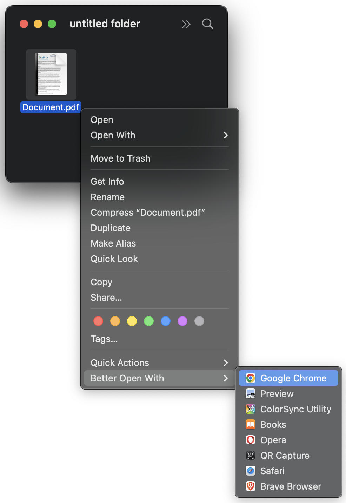
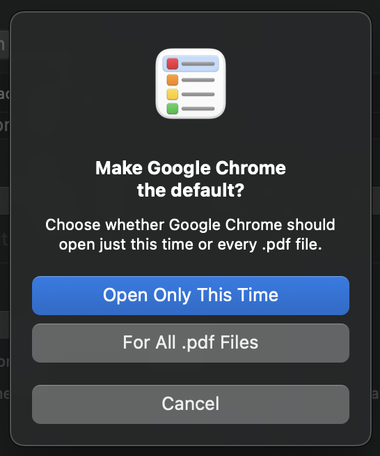

#  Better Open With

Better Open With is a small macOS utility for changing the default app for a
file type. Pick an extension, choose an installed compatible app, and apply
the system default—just like Finder’s **Get Info → Open with → Change All…**.

It also adds an optional Finder contextual menu for selecting an app without
leaving Finder.

## What it does

- Sets the macOS default app for an extension or content type, such as all
  PDFs, JSON files, or images.
- Lets you save and switch between named default-app profiles.
- Offers a Finder contextual menu with **Open Only This Time** and **For All
  .ext Files** choices.
- Can keep running from the menu bar after its window is closed.

## Finder workflow

Right-click a file in Finder, choose **Better Open With**, then select a
compatible app. The menu shows the installed apps that macOS can use for the
selected file.



Choose **Open Only This Time** to leave the current default unchanged, or
**For All .ext Files** to make the selected app the system default for that
extension.



### Experimental file-specific defaults

File-specific rules are disabled by default because macOS stores them as
metadata on the individual file. They can be less reliable than extension-wide
defaults when a file is copied, replaced, or stored on a service that does not
preserve macOS metadata.

To enable them, open **Settings** and turn on **Enable file-specific defaults
(Experimental)**. The File target and per-file options then appear with an
experimental label.

## Download and install

1. Download the latest `BetterOpenWith-*.zip` from the [Releases](../../releases/latest) page.
2. Unzip it and move **Better Open With.app** to `/Applications`.
3. Open the app. Because preview releases are not notarized, macOS may ask you
   to confirm that you want to open it. Control-click the app, choose **Open**,
   then confirm.
4. To add the Finder contextual menu, open **Settings** and choose **Manage
   Finder Extensions…**. Enable **Better Open With** there.

If the Finder menu does not appear after enabling the extension or installing
an update, relaunch Finder:

- Hold Option, right-click Finder in the Dock, and choose **Relaunch**; or
- Run this command in Terminal:

  ```sh
  killall Finder
  ```

To remove the menu later, return to **Manage Finder Extensions…** and turn off
**Better Open With**.

## Build from source

Requirements:

- macOS 12 or later
- Xcode 15 or later
- An Apple Development signing team if you want to run the Finder extension
  outside Xcode

Open `BetterOpenWith.xcodeproj` in Xcode, select the **BetterOpenWith** scheme,
set your signing team for both targets, then Run.

Or build from Terminal:

```sh
xcodebuild \
  -project BetterOpenWith.xcodeproj \
  -scheme BetterOpenWith \
  -configuration Debug \
  -sdk macosx \
  build
```

The app uses AppKit, Finder Sync, and Launch Services. Launch Services changes
can be briefly cached by Finder and other apps; relaunch Finder using one of
the methods above before treating a new association as failed.

## Release builds

Pushing a tag named `v*` runs the release workflow. It builds a ZIP containing
the app and publishes it to the matching GitHub Release. These builds are
unsigned and are intended for testing unless signing and notarization are added
by a maintainer.

## Technical notes

- Extension-wide defaults are stored by macOS Launch Services.
- Experimental file-specific defaults are stored with the file and take
  precedence over the extension-wide default.
- The Finder extension is the supported way to add a Finder contextual-menu
  command. Finder controls where third-party menu sections appear.
